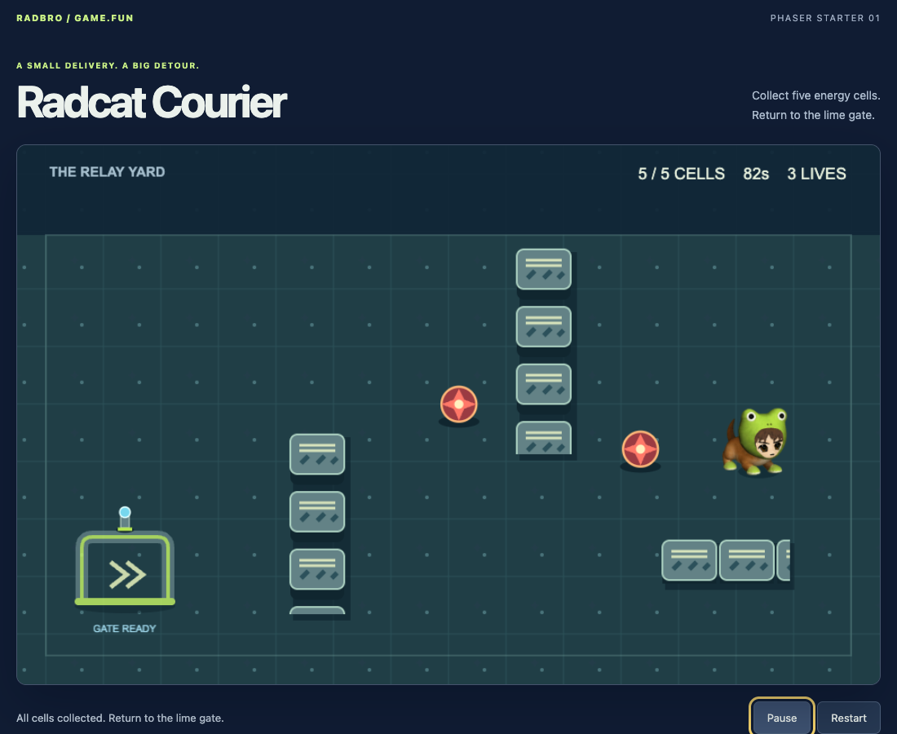
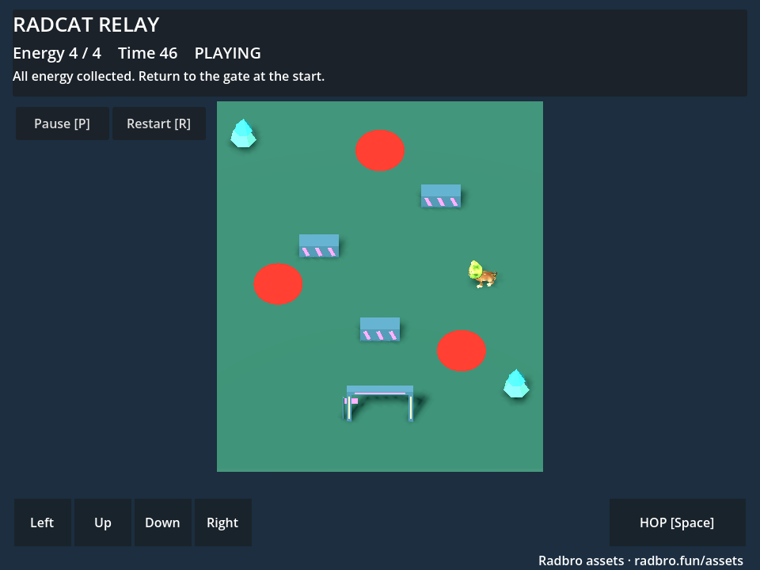

# Official Radbro Game Templates

Small games that you can play, change, and publish.
The first release uses Phaser and Godot.
Each template includes a complete play loop and uses the shared Radbro assets.

**[Play the demos](https://radbro.github.io/game-templates/)** · **[Browse assets](https://radbro.gg/assets)** · **[Download a release](https://github.com/radbro/game-templates/releases)**

| Template | Engine | Included |
| --- | --- | --- |
| [Radcat Courier](templates/phaser-radcat-courier) | Phaser 3.90.0 | Animated 2D sprites, wall collision, moving hazards, hop, collection, timer, keyboard, touch |
| [Radcat Relay](templates/godot-radcat-relay) | Godot 4.6.2 | Editable 3D scenes, rigged Radcat, prop kit, collision, hazards, hop, collection, timer, keyboard, touch, web export |





Both games include start, pause, success, failure, and restart states.
The source games need no account or API key.
Runtime assets and the Phaser library are local files.

## Run Phaser

Install Python 3.10 or later. Clone or download this repository.
Run these commands from its root:

```sh
python3 scripts/prepare.py phaser-radcat-courier
python3 scripts/serve.py
```

Open <http://127.0.0.1:8080/templates/phaser-radcat-courier/>.
Change `LEVEL` in `game-model.mjs` to make a new route.

For a release source ZIP, extract it and run `python3 -m http.server 8080`
in the extracted folder. Open <http://localhost:8080>.
The ZIP already includes its assets and Phaser runtime.

## Run Godot

Install [Godot 4.6.2](https://godotengine.org/download/archive/4.6.2-stable/).
Run `python3 scripts/prepare.py godot-radcat-relay` from the repository root.
Import `templates/godot-radcat-relay/project.godot` in Godot.
Press F6 in the main scene or F5 to run the project.
Open `scenes/main.tscn` to move props, pickups, barriers, and hazards.

A release source ZIP already contains the assets.
Import its `project.godot` directly.

## Export and publish

Phaser needs no compilation:

```sh
python3 scripts/package.py
```

Use `dist/phaser-radcat-courier-source.zip` as the browser build.
Its `index.html` is at the ZIP root.

Godot needs its matching export templates.
Install them with **Editor → Manage Export Templates**.
Use **Project → Export → Web → Export Project** to write `index.html`.
The preset uses Compatibility rendering and a single thread.
You can also export from the repository root:

```sh
mkdir -p build/godot-radcat-relay
godot --headless --path templates/godot-radcat-relay --editor --import
godot --headless --path templates/godot-radcat-relay --export-release Web
python3 scripts/build-site.py
```

The site and demos are in `dist/site/`.
The Godot browser ZIP is `dist/godot-radcat-relay-web.zip`.
Its `index.html` is at the ZIP root.
Keep all exported `.wasm`, `.pck`, `.js`, image, and license files together.
Use the source ZIP to edit the game. Use the web ZIP to host it.

Upload a browser ZIP through [Build games on Radbro](https://radbro.gg/build).
Accept the content policy and complete the normal submission flow.
New submissions require review before public listing.
This repository does not grant automatic listing or bypass review.

## Add assets and game types

The shared catalog starts with three packs:

- **Radcat Motion v2:** 3D idle, walk, jog, and hop; 2D idle, walk, and hop sprites.
- **Radcat Playground:** nine reusable 3D prop types.
- **Relay Arena 2D:** six new vector assets with a repeatable generation script.

Read [Add assets and templates](docs/adding-assets.md) for the release process
and the next platform, combat, racing, audio, and UI packs.
Use a new pack version when changing a released asset.
Unity and Unreal projects are planned for later releases.

## Verify

Install Node.js 22 for the source checks. There is no npm install step.

```sh
python3 scripts/prepare.py
python3 scripts/check.py
godot --headless --path templates/godot-radcat-relay --editor --import
godot --headless --fixed-fps 60 --path templates/godot-radcat-relay --script tests/smoke.gd
```

Browser checks need Playwright installed as a separate test tool.
After building the site, serve the repository on port 8096.
Set `PLAYWRIGHT_MODULE` to your installed Playwright `index.mjs` path.
Run `node tests/browser-smoke.mjs`.
Set `BROWSER_CHANNEL=chrome` to use an installed Google Chrome.
CI installs its browser tools in a temporary folder.
It can verify both games before publishing the demo site.
The initial hosted job could not start because the organization has a billing lock.
The current demos use locally verified artifacts on the `codex/site` branch.

The tests cover rules, source hashes, sprite timing, engine import, motion,
collisions, outcomes, browser controls, and restricted iframe loading.
See [Release verification](docs/verification.md) for tested limits.

## Licenses

Original code and documentation use the [MIT license](LICENSE).
**The root MIT license does not cover character art or asset files.**
Each asset pack includes its own `LICENSE.txt` and source record.
Credit Radbro and keep those notices with shared asset files.
Phaser and Godot keep their own MIT notices.
See [Credits](CREDITS.md) and [Asset sources](docs/asset-provenance.md).
